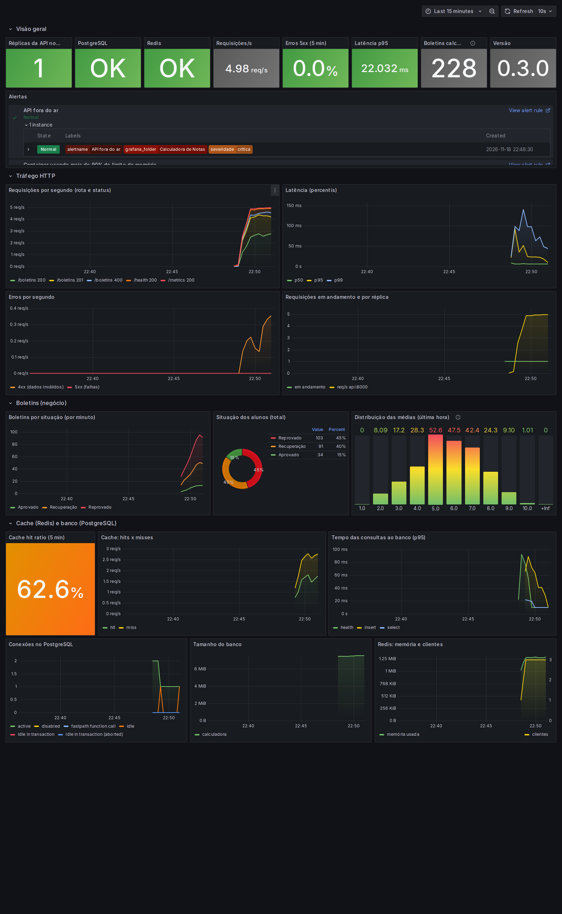
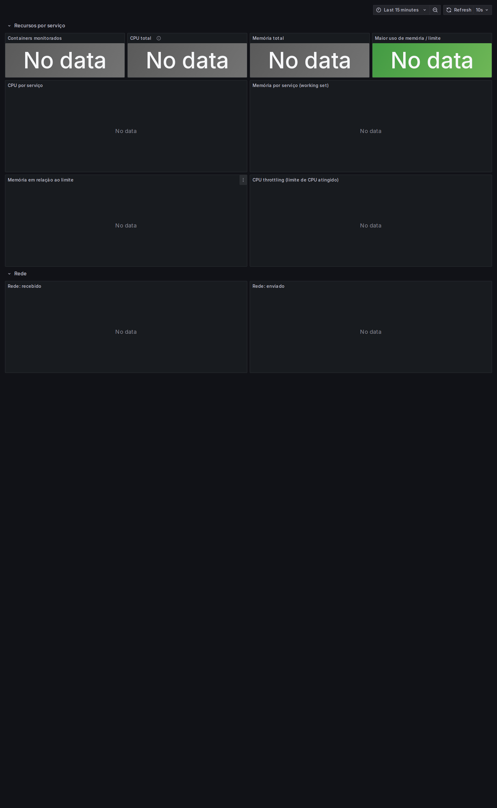
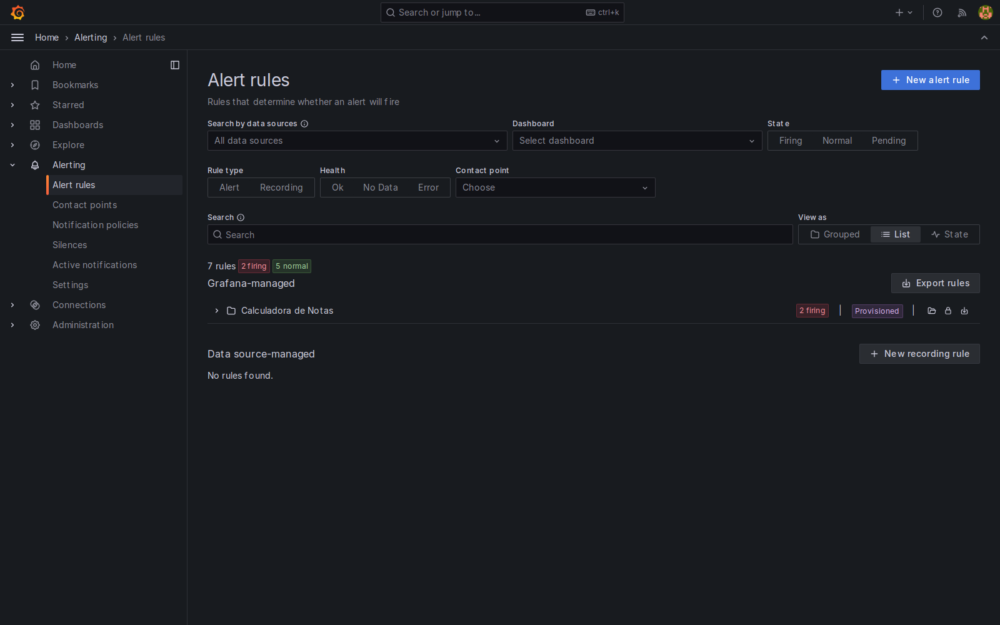
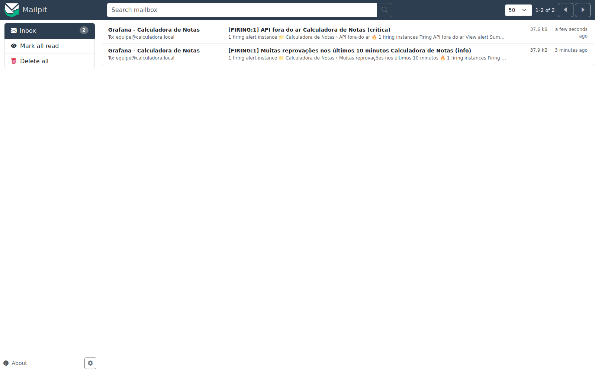
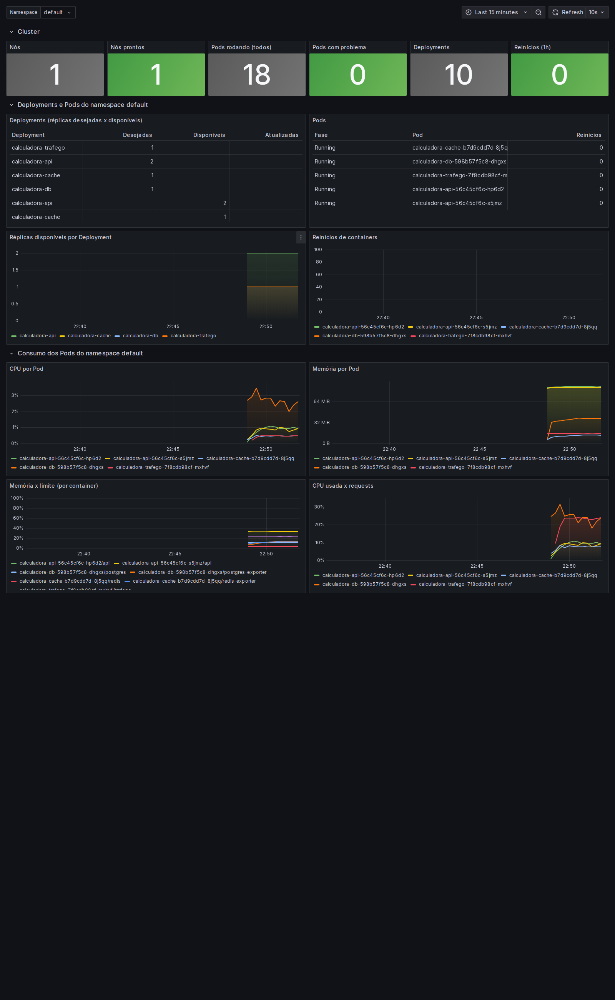
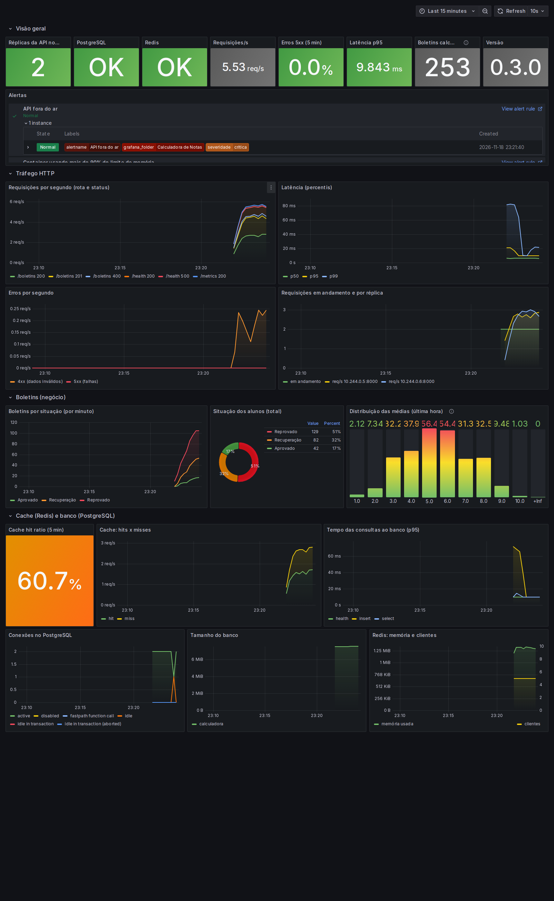
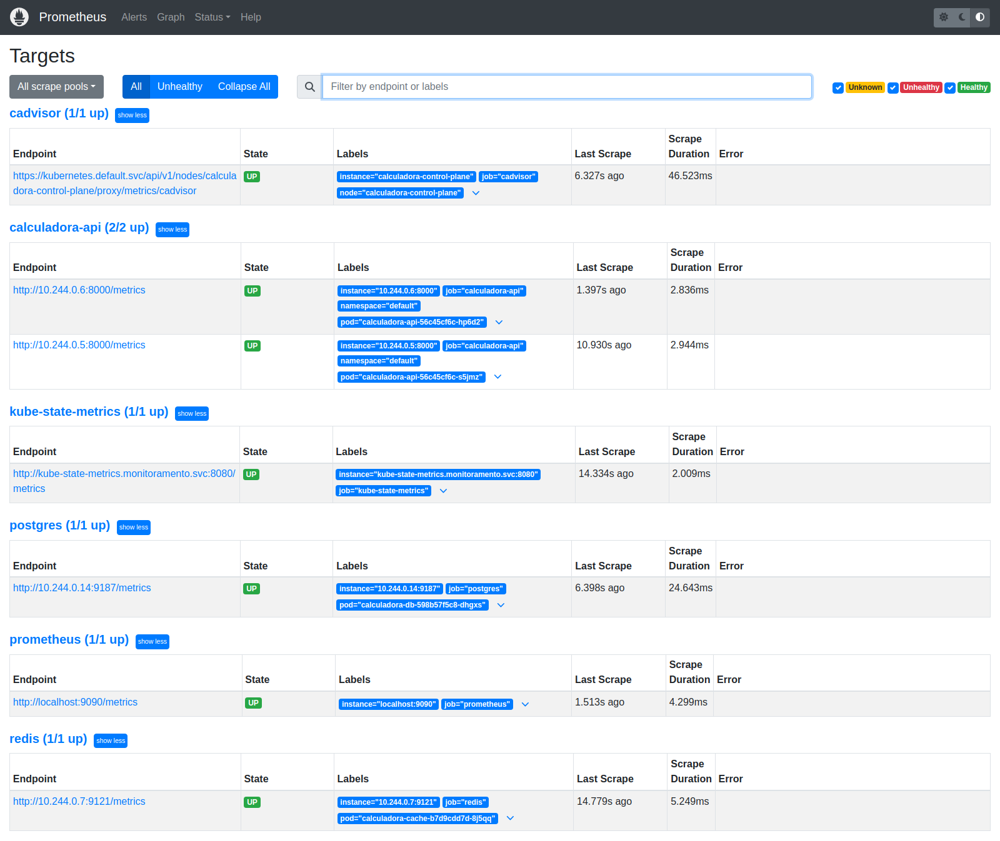

# Calculadora de Notas

[](https://github.com/Davi-Barbara-Carvalho/calculadora-notas/actions/workflows/ci.yml)

Aplicação em Python que calcula médias escolares e informa a situação do aluno, com uma API HTTP,
banco PostgreSQL, cache Redis e toda a parte de operação: imagens Docker, Docker Compose,
Kubernetes, métricas no Prometheus e dashboards/alertas no Grafana.

**Integrantes:**

| Nome                     | RA     |
|--------------------------|--------|
| Davi Barbara Carvalho    | 220455 |
| Gustavo Rodrigues Barbosa| 219293 |

## O que foi implementado (conteúdo desde a B2)

| Tema                    | Onde está                                                                                          |
|-------------------------|----------------------------------------------------------------------------------------------------|
| Testes e CI             | `tests/`, `.github/workflows/ci.yml` (pytest, build, Compose e Kubernetes no GitHub Actions)        |
| Imagem Docker           | `Dockerfile` multi-stage (`build`, `test`, `runtime`), publicada no GHCR pelo CI                    |
| Dependências em Docker  | Imagens prontas: `postgres:16-alpine`, `redis:7-alpine`, Prometheus, Grafana, exporters, Mailpit   |
| Docker Compose          | `docker-compose.yml` (aplicação + monitoramento) e `docker-compose.test.yml` (testes)              |
| Kubernetes              | `k8s/` + `kustomization.yaml`: tudo sobe com `kubectl apply -k .`                                  |
| Prometheus              | Instrumentação da API (`src/calculadora/metricas.py`), `monitoring/prometheus/`                    |
| Métricas dos containers | cAdvisor (Compose) e cAdvisor do kubelet + kube-state-metrics (Kubernetes)                         |
| Grafana                 | 3 dashboards e 7 regras de alerta provisionados por arquivo (`monitoring/grafana/`)                |
| Alertas                 | Enviados por e-mail; o Mailpit funciona como caixa de entrada local para ver os alertas chegando   |

```
                 ┌──────────────── Docker Compose / Kubernetes ────────────────┐
  usuário ──► API (Flask + Gunicorn) ──► PostgreSQL ◄── postgres-exporter     │
                │   /metrics            Redis      ◄── redis_exporter         │
                │                                                             │
                ▼                                                             │
           Prometheus ◄── cAdvisor (containers) / kube-state-metrics (k8s)    │
                │                                                             │
                ▼                                                             │
             Grafana ──► dashboards + regras de alerta ──► e-mail (Mailpit)   │
                 └─────────────────────────────────────────────────────────────┘
```

## Funcionalidades

- Validação de notas (precisa ser um número entre 0 e 10)
- Média aritmética e média ponderada
- Situação do aluno: Aprovado (>= 7), Recuperação (>= 5) ou Reprovado
- Cálculo da nota necessária na última avaliação para ser aprovado
- Boletim resumido do aluno
- Interface de linha de comando
- API HTTP: `GET /health`, `POST /boletins`, `GET /boletins`, `GET /metrics`

## Instalação local (sem Docker)

```bash
git clone https://github.com/Davi-Barbara-Carvalho/calculadora-notas.git
cd calculadora-notas

python -m venv .venv
source .venv/bin/activate      # Windows: .venv\Scripts\activate

pip install -r requirements.txt
pip install -e .
calculadora --aluno "Maria" --notas 8 7.5 9
```

Saída:

```
Aluno:    Maria
Notas:    8.0, 7.5, 9.0
Média:    8.17
Situação: Aprovado
```

## Testes

```bash
pytest                                  # testes unitários
pytest --cov=src/calculadora            # com relatório de cobertura
```

Os testes da API e das métricas rodam no container, contra Postgres e Redis reais:

```bash
docker compose -f docker-compose.test.yml up --build --abort-on-container-exit --exit-code-from testes
docker compose -f docker-compose.test.yml down -v
```

## Imagem Docker

`Dockerfile` multi-stage:

| Estágio   | Para que serve                                                         |
|-----------|------------------------------------------------------------------------|
| `build`   | Gera o pacote (wheel) com `python -m build`                            |
| `test`    | Instala as dependências de teste e roda o `pytest`                     |
| `runtime` | Imagem final enxuta, com o pacote instalado e usuário sem privilégios  |

```bash
docker build -t calculadora-notas .
docker run --rm calculadora-notas --aluno "Maria" --notas 8 7.5 9
```

A cada push na `main`, o CI publica a imagem em `ghcr.io/davi-barbara-carvalho/calculadora-notas`
(tags `latest` e SHA do commit).

## Docker Compose (aplicação + monitoramento)

```bash
docker compose up -d --build --wait               # sobe tudo
docker compose --profile carga up -d trafego      # gerador de tráfego (enche os gráficos)
docker compose ps
```

| Serviço             | Imagem                                           | Endereço                      |
|---------------------|--------------------------------------------------|-------------------------------|
| `api`               | `ghcr.io/davi-barbara-carvalho/calculadora-notas`| http://localhost:8000         |
| `db`                | `postgres:16-alpine`                             | (rede interna)                |
| `cache`             | `redis:7-alpine`                                 | (rede interna)                |
| `prometheus`        | `prom/prometheus:v2.55.1`                        | http://localhost:9090         |
| `grafana`           | `grafana/grafana:11.3.1`                         | http://localhost:3000 (admin/admin) |
| `cadvisor`          | `gcr.io/cadvisor/cadvisor:v0.49.1`               | http://localhost:8080         |
| `postgres-exporter` | `quay.io/prometheuscommunity/postgres-exporter`  | (rede interna)                |
| `redis-exporter`    | `oliver006/redis_exporter`                       | (rede interna)                |
| `mailpit`           | `axllent/mailpit`                                | http://localhost:8025 (e-mails dos alertas) |
| `trafego`           | imagem do projeto (profile `carga`)              | -                             |
| `calculadora`       | imagem do projeto (profile `cli`)                | -                             |

- **Redes:** `frontend` publica a API; `backend` é `internal` (banco, cache e exporters sem acesso
  externo); `monitoramento` liga Prometheus, Grafana, cAdvisor e Mailpit.
- **Volumes:** `pgdata`, `redisdata`, `prometheusdata` e `grafanadata` (só `down -v` apaga).
- **Healthchecks e limites:** a API só sobe com banco e cache saudáveis; `api`, `db` e `cache` têm
  limites de CPU/memória (usados no painel e no alerta de memória).

```bash
curl -X POST localhost:8000/boletins -H 'Content-Type: application/json' \
     -d '{"aluno": "Maria", "notas": [8, 7.5, 9]}'
curl -i localhost:8000/boletins          # X-Cache: MISS/HIT
curl localhost:8000/metrics              # métricas no formato do Prometheus
docker compose run --rm calculadora --aluno "João" --notas 5 6 4
docker compose down                      # para (mantém os volumes)
```

## Kubernetes (Minikube)

Tudo é provisionado com **um comando** pelo `kustomization.yaml` da raiz:

```bash
minikube start --driver=docker --cpus=2 --memory=4g
kubectl apply -k .
kubectl get pods -A -w                   # espere tudo ficar Running
kubectl apply -f k8s/trafego.yaml        # (opcional) gerador de tráfego
```

| Arquivo                                  | Recursos                                                                     |
|------------------------------------------|------------------------------------------------------------------------------|
| `k8s/postgres.yaml`                      | Secret, ConfigMap (`init.sql`), PVC, Deployment (Postgres + sidecar exporter), Service `db` |
| `k8s/redis.yaml`                         | Deployment (Redis + sidecar exporter) e Service `cache`                      |
| `k8s/deployment.yaml`                    | Deployment `calculadora-api` (2 réplicas, probes, limites, rolling update)  |
| `k8s/service.yaml`                       | Service NodePort `calculadora-api-service` (30080)                           |
| `k8s/monitoramento/namespace.yaml`       | Namespace `monitoramento`                                                    |
| `k8s/monitoramento/prometheus.yaml`      | ServiceAccount + RBAC, Deployment e Service NodePort (30090)                  |
| `k8s/monitoramento/kube-state-metrics.yaml` | ServiceAccount + RBAC, Deployment e Service                               |
| `k8s/monitoramento/grafana.yaml`         | Secret (admin), Deployment e Service NodePort (30030)                        |
| `k8s/monitoramento/mailpit.yaml`         | Deployment e Service (SMTP 1025, web 30025)                                  |
| `k8s/trafego.yaml`                       | Gerador de tráfego (opcional)                                                |
| `kustomization.yaml`                     | Junta tudo e gera os ConfigMaps do Prometheus e do Grafana a partir de `monitoring/` |

O Prometheus descobre os Pods pela API do Kubernetes: ao escalar a API, as réplicas novas entram
na coleta sozinhas.

Acessando (em terminais separados, ou use `minikube service <nome> -n monitoramento`):

```bash
kubectl port-forward service/calculadora-api-service 8000:80
kubectl -n monitoramento port-forward service/grafana 3000:3000
kubectl -n monitoramento port-forward service/prometheus 9090:9090
kubectl -n monitoramento port-forward service/mailpit 8025:8025
```

Operações:

```bash
kubectl scale deployment calculadora-api --replicas=4          # escalar
kubectl rollout restart deployment/calculadora-api             # rolling update
kubectl rollout undo deployment/calculadora-api                # rollback
kubectl delete -k . && minikube stop                           # limpeza
```

## Monitoramento

### Métricas da API (instrumentação)

A API usa o `prometheus_client` (`src/calculadora/metricas.py`). Como o Gunicorn roda vários
workers, as métricas usam o **modo multiprocess** (`PROMETHEUS_MULTIPROC_DIR`) para somar os
valores de todos os processos (`src/calculadora/gunicorn_conf.py`).

| Métrica                                        | Tipo      | Rótulos                       |
|------------------------------------------------|-----------|-------------------------------|
| `calculadora_http_requests_total`              | counter   | `metodo`, `endpoint`, `status`|
| `calculadora_http_request_duration_seconds`    | histogram | `metodo`, `endpoint`          |
| `calculadora_http_requests_in_progress`        | gauge     | -                             |
| `calculadora_boletins_total`                   | counter   | `situacao`                    |
| `calculadora_boletim_media`                    | histogram | -                             |
| `calculadora_notas_invalidas_total`            | counter   | -                             |
| `calculadora_cache_requests_total`             | counter   | `resultado` (`hit`/`miss`)    |
| `calculadora_db_query_duration_seconds`        | histogram | `operacao`                    |
| `calculadora_app_info`                         | gauge     | `versao`                      |

### Prometheus

Jobs (mesmos nomes no Compose e no Kubernetes): `calculadora-api`, `postgres`, `redis`,
`cadvisor`, `prometheus` e, no Kubernetes, `kube-state-metrics`. Veja em **Status → Targets**.

### Dashboards do Grafana

| Dashboard                          | O que mostra                                                                  |
|------------------------------------|-------------------------------------------------------------------------------|
| Calculadora de Notas - API         | Réplicas no ar, req/s, erros, latência p50/p95/p99, boletins por situação, distribuição das médias, cache hit ratio, banco e Redis, lista de alertas |
| Calculadora de Notas - Containers  | CPU, memória (absoluta e em relação ao limite), throttling e rede por serviço |
| Kubernetes - Cluster               | Nós, Pods, Deployments (réplicas desejadas x disponíveis), reinícios, CPU e memória por Pod |

### Alertas

As regras ficam em `monitoring/grafana/provisioning/alerting/alertas.yml` e vão por e-mail para o
ponto de contato `email-equipe`. Por padrão o SMTP é o **Mailpit** (http://localhost:8025), então
dá para ver os e-mails chegando sem configurar nada. Para receber num e-mail de verdade, preencha
`SMTP_*` e `ALERTA_EMAIL` no `.env` (veja `.env.example`).

| Alerta                                   | Condição                                 | Severidade |
|------------------------------------------|------------------------------------------|------------|
| API fora do ar                           | nenhuma réplica respondendo por 30 s     | crítica    |
| PostgreSQL fora do ar                    | `pg_up < 1` por 30 s                     | crítica    |
| Redis fora do ar                         | `redis_up < 1` por 30 s                  | crítica    |
| Taxa de erros 5xx acima de 5%            | por 1 min                                | alta       |
| Latência p95 acima de 500 ms             | por 2 min                                | média      |
| Container usando > 90% do limite de memória | por 2 min                             | média      |
| Muitas reprovações nos últimos 10 minutos| mais de 20 boletins "Reprovado"          | info       |

Para ver um alerta disparar:

```bash
docker compose stop db      # "PostgreSQL fora do ar" e, com tráfego, "Taxa de erros 5xx"
docker compose stop api     # "API fora do ar"
# Kubernetes: kubectl scale deployment calculadora-api --replicas=0
```

Em cerca de 1 minuto o alerta aparece em **Alerting → Alert rules** e o e-mail chega no Mailpit.
Depois é só subir o serviço de novo (`docker compose start db`) para receber o e-mail de "Resolved".

## Pipeline de CI

`.github/workflows/ci.yml` roda a cada push e pull request na `main`:

1. **Testes e build** (Python 3.10, 3.11 e 3.12): pytest com cobertura e build do pacote.
2. **Docker Compose**: testes com Postgres e Redis reais; sobe a stack inteira; testes de fumaça da
   API, do `/metrics` e da CLI; confere se o Prometheus coleta todos os alvos e se o Grafana tem
   dashboards, alertas e ponto de contato; derruba a API e **espera o e-mail de alerta chegar**;
   em push na `main`, publica a imagem no GHCR.
3. **Kubernetes (kind)**: cria um cluster, roda `kubectl apply -k .`, espera os rollouts, faz as
   mesmas verificações de monitoramento, escala, faz rolling update e testa o alerta de ponta a ponta.

Os jobs 2 e 3 tiram **prints** do Grafana, do Prometheus e do Mailpit (e salvam o `kubectl get`)
e publicam como artefatos `prints-docker-compose` e `prints-kubernetes` na página da execução.
Para tirar os prints na sua máquina: `python scripts/prints_grafana.py --saida prints/`
(precisa de `pip install playwright && python -m playwright install chromium`).

## Prints

Gerados automaticamente pelo CI a cada push na `main` (job "Salvar prints no repositório"),
na pasta [`docs/prints/`](docs/prints).

### Docker Compose

| Dashboard da API | Containers |
|---|---|
|  |  |

| Alerta disparado (Grafana) | E-mail do alerta (Mailpit) |
|---|---|
|  |  |

### Kubernetes

| Cluster | Dashboard da API |
|---|---|
|  |  |

| Alvos do Prometheus | Alerta "API fora do ar" |
|---|---|
|  |  |

Saída do `kubectl get`: [`docs/prints/kubernetes/kubectl-get.txt`](docs/prints/kubernetes/kubectl-get.txt)

## GitHub Codespaces

O `.devcontainer/devcontainer.json` (imagem `universal:2`) já tem Python e Docker e encaminha as
portas 8000, 3000, 9090, 8025 e 8080. Ao terminar, pare o Codespace para não gastar horas:
`gh codespace stop` ou, em github.com/codespaces, **⋯ → Stop codespace**.

## Estrutura do projeto

```
calculadora-notas/
├── .devcontainer/devcontainer.json
├── .github/workflows/ci.yml
├── Dockerfile
├── docker-compose.yml               # aplicação + monitoramento
├── docker-compose.test.yml          # ambiente de testes
├── kustomization.yaml               # kubectl apply -k .
├── db/init.sql
├── k8s/
│   ├── deployment.yaml  postgres.yaml  redis.yaml  service.yaml  trafego.yaml
│   └── monitoramento/
│       ├── namespace.yaml  prometheus.yaml  kube-state-metrics.yaml
│       └── grafana.yaml  mailpit.yaml
├── monitoring/
│   ├── prometheus/prometheus.yml  prometheus-k8s.yml
│   └── grafana/
│       ├── provisioning/  datasources/  dashboards/  alerting/
│       └── dashboards/    calculadora/  kubernetes/
├── scripts/
│   ├── verificar_monitoramento.py   # checagens usadas no CI
│   └── prints_grafana.py            # prints automáticos
├── src/calculadora/
│   ├── api.py  cli.py  operacoes.py
│   ├── metricas.py  gunicorn_conf.py  trafego.py
└── tests/
    ├── test_api.py  test_cli.py  test_metricas.py  test_operacoes.py
```

## Licença

MIT
